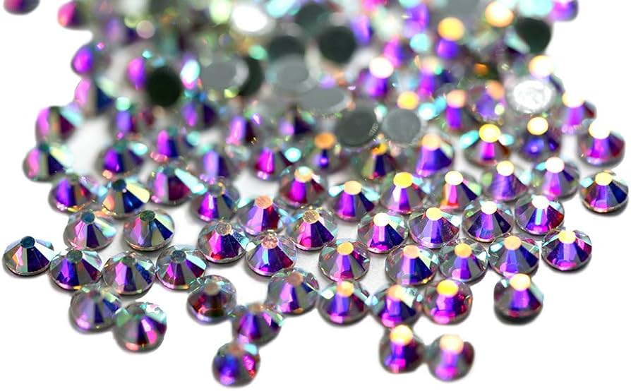
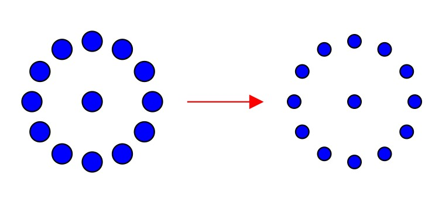
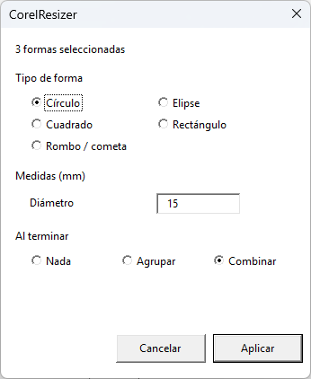
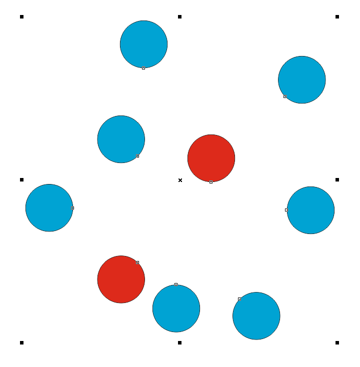

# CorelResizer

## Introducción

Este proyecto tiene como objetivo solucionar una problemática de Corel Draw acerca de cómo redimensiona un conjunto de objetos. La macro ajusta círculos, elipses, cuadrados, rectángulos, rombos y cometas a las medidas indicadas, manteniendo la posición de cada uno.

## Aplicación :gem:

Al realizar diseños para strass se utilizan programas de dibujo vectorizado. En el programa Corel Draw se ha detectado un problema con el redimensionado de múltiples objetos, y este problema es el siguiente: 

Si tenemos dibujados varios objetos circulares de un tamaño ss10 (3mm) y queremos cambiarlos por otros de tamaño ss06 (2mm), debemos de ir seleccionando cada uno de los objetos y redimensionarlo uno por uno, ya que no existe herramienta que tras hacer la selección de todos estos objetos cambie el tamaño de cada uno de los objetos manteniendo su posición. 

Este tipo de diseños es muy usual en sectores como el del calzado, confección, bolsos, etc... Como podremos imaginar la variedad de diseños es muy amplia, habiendo unos muy sencillos con una cantidad pequeña de cristales y otros que utilizan más de 8000. Cuando queremos hacer pruebas para ver que efecto nos hace cambiar el tamaño de los cristales en estos diseños tan complejos es cuando el trabajo que supone redimensionarlos uno por uno es muy tedioso. Por este motivo me decidí a realizar un macro que automatizara esta función, disminuyendo significativamente el tiempo en realizar el trabajo, así como la eliminación de errores por la manipulación de cada uno de los objetos.

Además, al encajar un diseño en un patrón es habitual estirarlo, girarlo o inclinarlo, lo que deforma todos los cristales: los círculos pasan a ser elipses y los cuadrados, romboides. La macro recupera la forma correcta de cada cristal con las medidas indicadas, manteniendo su centro y su orientación.

### Capturas de Pantalla

#### Formulario

#### Antes y después
| Formas deformadas | Tras aplicar la macro |
|:---:|:---:|
|  |  |

## Instalación y uso :rocket:

### Instalación

1. Descarga de la [última Release](https://github.com/fernandomacia/CorelResizer/releases/latest) los archivos `CorelResizer.bas`, `frmCorelResizer.frm` y `frmCorelResizer.frx`, y guárdalos en la misma carpeta. No los descargues desde la vista del código de GitHub: ahí están en UTF-8 y las tildes se verían mal en CorelDRAW.
2. En CorelDRAW abre el editor de VBA (`Alt + F11`).
3. Si tenías una versión anterior, elimina `modCorelResizer` (y `frmCorelResizer`, si existe) del proyecto **GlobalMacros**.
4. Con **GlobalMacros** seleccionado, menú **File → Import File...** e importa `CorelResizer.bas` y después `frmCorelResizer.frm` (el `.frx` se carga automáticamente).

### Uso

1. Selecciona las formas a redimensionar. Pueden estar sueltas, agrupadas o combinadas en una sola curva, pero todas del mismo tipo.
2. Ejecuta la macro desde **Herramientas → Macros → Ejecutar macro** → `CorelResizer`.
3. Elige el tipo de forma e introduce las medidas en milímetros (se admite `2,5` o `2.5`):

   | Tipo | Medidas |
   |---|---|
   | Círculo | Diámetro |
   | Elipse | Eje largo y eje corto |
   | Cuadrado | Lado |
   | Rectángulo | Lado largo y lado corto |
   | Rombo / cometa | Diagonal larga y diagonal corta |

4. Elige qué hacer al terminar: nada, agrupar o combinar las formas, y pulsa **Aplicar**.

Cada forma conserva su centro y su orientación aunque estuviera estirada, girada o inclinada. Todo el proceso se deshace con un único `Ctrl + Z`.

No se admiten formas con esquinas redondeadas ni romboides (paralelogramos que no son rectángulos ni rombos).

### Botón en la barra de herramientas (opcional)

1. **Herramientas → Opciones → Personalización → Comandos**.
2. En el desplegable elige **Macros** y arrastra `CorelResizer` a una barra de herramientas.
3. En la pestaña **Apariencia**, importa `static/ico/resize_5345276.ico` como imagen del botón.

## Tecnologías Utilizadas :hammer_and_wrench:

- **VBA** (Visual Basic for Applications): Lenguaje de macros de Corel Draw utilizado para el desarrollo del macro.
- **Corel Draw**: Programa de diseño vectorizado donde vamos a utilizar el macro programado.

## Versiones :pushpin:

Esta macro ha sido probada en CorelDRAW X6, X7 y X8.

Los cambios de cada versión están en el [CHANGELOG](CHANGELOG.md).

## Créditos :art:

- Icono del botón (`static/ico/resize_5345276.ico`): [King size icons created by rukanicon - Flaticon](https://www.flaticon.com/free-icons/king-size). Se distribuye con la licencia de Flaticon, no con la GPL del proyecto.

## Licencia :page_with_curl:

Este proyecto está bajo la licencia [GNU GPL v3.0](LICENSE): puedes usar, modificar y compartir la macro libremente, pero cualquier versión que se distribuya debe mantener esta misma licencia e incluir su código fuente. Los recursos de terceros tienen su propia licencia (ver *Créditos*).

## Autor

- [Fernando Maciá](https://github.com/fernandomacia)

